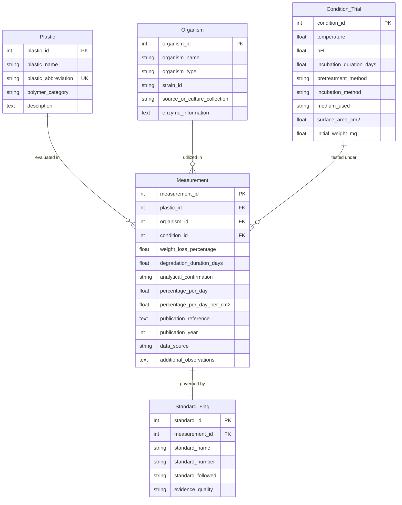

# Plastic Biodegradation Trial Database and Analysis System (PlastiDeg DB)

[](https://www.python.org/)
[](https://www.mysql.com/)
[](https://streamlit.io/)
[](LICENSE)

An academic biotechnology, data engineering, and scientific analytics platform designed to collect, curate, manage, and comparatively evaluate published peer-reviewed experimental data on the microbial biodegradation of synthetic and bio-based plastics.

---

## Table of Contents
1. [Project Introduction](#1-project-introduction)
2. [Problem Statement](#2-problem-statement)
3. [Project Objectives](#3-project-objectives)
4. [Existing System vs. Proposed System](#4-existing-system-vs-proposed-system)
5. [Technologies Used](#5-technologies-used)
6. [Relational Database Architecture](#6-relational-database-architecture)
   - [Entity-Relationship (ER) Diagram](#entity-relationship-er-diagram)
   - [Database Table Schemas](#database-table-schemas)
7. [Mathematical & Scientific Calculations](#7-mathematical--scientific-calculations)
8. [Evidence-Quality Classification vs. Testing Standards](#8-evidence-quality-classification-vs-testing-standards)
9. [Covered Target Plastics](#9-covered-target-plastics)
10. [Project Directory Structure](#10-project-directory-structure)
11. [Installation & Setup Guide](#11-installation--setup-guide)
    - [Prerequisites](#prerequisites)
    - [Environment Setup](#environment-setup)
    - [MySQL Database Setup](#mysql-database-setup)
    - [Zero-Configuration SQLite Fallback](#zero-configuration-sqlite-fallback)
12. [Running the Application](#12-running-the-application)
13. [Dashboard Features & Walkthrough](#13-dashboard-features--walkthrough)
14. [Running Unit Tests](#14-running-unit-tests)
15. [College Evaluation & Viva Demonstration Guide](#15-college-evaluation--viva-demonstration-guide)
16. [Future Scope](#16-future-scope)
17. [Academic References](#17-academic-references)

---

## 1. Project Introduction

Plastic accumulation in terrestrial and aquatic environments represents one of the most critical environmental crises of the Anthropocene. While biological degradation by bacteria, fungi, and microbial consortia offers an eco-friendly path toward plastic bioremediation and upcycling, experimental results across scientific literature remain fragmented, non-standardized, and difficult to compare.

The **Plastic Biodegradation Trial Database and Analysis System (PlastiDeg DB)** provides a centralized, relational scientific database and an interactive analysis dashboard. It equips researchers, environmental biotechnologists, and students with tools to systematically compare microbial depolymerization kinetics, evaluate substrate pretreatments, scrutinize analytical evidence quality, and generate publication-ready comparative reports.

---

## 2. Problem Statement

Experimental data regarding plastic biodegradation suffers from significant discrepancies:
1. **Dispersed Data:** Studies are scattered across hundreds of distinct journals across microbiology, polymer science, and environmental biotechnology.
2. **Ambiguous Analytical Evidence:** Many preliminary publications claim "biodegradation" based purely on gravimetric mass loss (which can be caused by plasticizer leaching or biofilm mass fluctuations) without spectroscopic confirmation of polymer chain scission.
3. **Conflation with Standards:** Compliance with industrial standards (e.g., ISO 14855, ASTM D5338) is frequently conflated with academic research methodologies.
4. **Lack of Computational Tools:** Researchers lack intuitive software tools to compute surface-area normalized degradation rates, perform cross-polymer comparisons, and export filtered datasets.

---

## 3. Project Objectives

- **Database Architecture:** Design and implement a normalized relational MySQL schema (`plastic_biodegradation_db`) with 5 core tables.
- **Polymer Scope:** Comprehensively cover six target polymers: PET, PE, PP, PS, PLA, and PHA.
- **Scientific Integrity:** Curate genuine, peer-reviewed literature records (e.g. *Ideonella sakaiensis*, *Rhodococcus ruber*, *Thermobifida fusca*, mealworm gut microbiomes) with accessible DOIs, distinguishing them from illustrative demo trials.
- **Normalized Rate Computation:** Develop validated Python algorithms for gravimetric weight loss percentage, daily degradation rate (%/day), and surface-area normalized rate (%/day/cm²).
- **Four-Tier Evidence Classification:** Stratify analytical evidence quality (HIGH, MODERATE, LOW, UNVERIFIED) based on analytical techniques (FTIR, SEM, GPC, NMR, GC-MS).
- **Interactive UI Dashboard:** Build a modern multi-page Streamlit application with interactive Plotly visualizations and export capabilities (CSV, Excel, vector PDF).

---

## 4. Existing System vs. Proposed System

| Parameter | Existing System / Conventional Practice | Proposed System (PlastiDeg DB) |
| :--- | :--- | :--- |
| **Data Storage** | Static spreadsheets (Excel/CSV) or isolated PDF papers | Normalized relational MySQL database with foreign keys |
| **Analytical Rigor** | Weight loss often reported uncritically | 4-tier analytical evidence quality classification (FTIR, SEM, GPC) |
| **Standard Compliance** | Conflated with general degradation claims | Clear separation between analytical rigor and ASTM/ISO standards |
| **Kinetic Rates** | Raw weight loss without standard normalization | Real-time calculation of %/day and %/day/cm² |
| **Data Validation** | Manual data entry without constraint checking | Strict range validation (pH, Temp, Weight, Duration) and duplicate check |
| **Reporting** | Manual copy-pasting into documents | Automated export to CSV, Excel (.xlsx), and academic vector PDF |

---

## 5. Technologies Used

- **Programming Language:** Python 3.10+
- **Relational Database Management System:** MySQL 8.0+ (with PyMySQL & SQLAlchemy ORM)
- **Embedded Database Engine:** SQLite3 (automated graceful fallback)
- **Interactive Web Interface:** Streamlit
- **Scientific Computing & Dataframes:** Pandas & NumPy
- **Interactive Visualizations:** Plotly Express & Plotly Graph Objects
- **Vector PDF & Report Generation:** Matplotlib (`matplotlib.backends.backend_pdf.PdfPages`) & OpenPyXL
- **Environment & Configuration:** Python-Dotenv
- **Automated Testing:** Pytest

---

## 6. Relational Database Architecture

The relational schema is named `plastic_biodegradation_db` and strictly adheres to Third Normal Form (3NF).

### Entity-Relationship (ER) Diagram



### Database Table Schemas

#### Table 1: `Plastic`
Stores substrate chemistry, abbreviation, polymer class, and degradation characteristics.
- `plastic_id` (INT, Primary Key, Auto Increment)
- `plastic_name` (VARCHAR(100), NOT NULL)
- `plastic_abbreviation` (VARCHAR(20), NOT NULL, UNIQUE)
- `polymer_category` (VARCHAR(100), NOT NULL)
- `description` (TEXT)

#### Table 2: `Organism`
Catalogs microbial strains, consortia, and depolymerase enzyme systems.
- `organism_id` (INT, Primary Key, Auto Increment)
- `organism_name` (VARCHAR(150), NOT NULL)
- `organism_type` (ENUM: Bacteria, Fungi, Consortium, Enzyme/Cell-free)
- `strain_id` (VARCHAR(100), Default: 'Unspecified')
- `source_or_culture_collection` (VARCHAR(150))
- `enzyme_information` (TEXT)

#### Table 3: `Condition_Trial`
Captures environmental and physical cultivation parameters.
- `condition_id` (INT, Primary Key, Auto Increment)
- `temperature` (FLOAT, NOT NULL, °C)
- `pH` (FLOAT, NOT NULL)
- `incubation_duration_days` (FLOAT, NOT NULL, Days)
- `pretreatment_method` (VARCHAR(100), e.g., UV, Heat, None)
- `incubation_method` (VARCHAR(100), e.g., Liquid shake flask, Soil burial)
- `medium_used` (VARCHAR(150), e.g., Mineral Salt Medium)
- `surface_area_cm2` (FLOAT, NULL, cm²)
- `initial_weight_mg` (FLOAT, NULL, mg)

#### Table 4: `Measurement`
Contains quantitative gravimetric data, normalized rates, and bibliographic citations.
- `measurement_id` (INT, Primary Key, Auto Increment)
- `plastic_id` (INT, Foreign Key referencing Plastic)
- `organism_id` (INT, Foreign Key referencing Organism)
- `condition_id` (INT, Foreign Key referencing Condition_Trial)
- `weight_loss_percentage` (FLOAT, NOT NULL)
- `degradation_duration_days` (FLOAT, NOT NULL)
- `analytical_confirmation` (VARCHAR(150), e.g., FTIR + SEM)
- `percentage_per_day` (FLOAT, NOT NULL, %/day)
- `percentage_per_day_per_cm2` (FLOAT, NULL, %/day/cm²)
- `publication_reference` (TEXT, NOT NULL)
- `publication_year` (INT)
- `data_source` (ENUM: Verified Literature, Illustrative Demo)
- `additional_observations` (TEXT)

#### Table 5: `Standard_Flag`
Categorizes analytical evidence quality and ASTM/ISO standard adherence.
- `standard_id` (INT, Primary Key, Auto Increment)
- `measurement_id` (INT, Foreign Key referencing Measurement)
- `standard_name` (ENUM: ASTM, ISO, None, Not reported)
- `standard_number` (VARCHAR(100), e.g., ISO 14855)
- `standard_followed` (VARCHAR(20), Default: 'No')
- `evidence_quality` (ENUM: HIGH, MODERATE, LOW, UNVERIFIED)

---

## 7. Mathematical & Scientific Calculations

The Python calculation engine (`calculations.py`) executes three validated equations:

### A. Gravimetric Weight Loss Percentage
$$\text{Weight Loss (\%)} = \left(\frac{W_{\text{initial}} - W_{\text{final}}}{W_{\text{initial}}}\right) \times 100$$
*Validation:* $W_{\text{initial}} > 0$. If $W_{\text{final}} > W_{\text{initial}}$, the system detects mass accretion (e.g. biofilm biomass attachment or hydration) and logs an informative warning.

### B. Daily Normalized Degradation Rate
$$\text{Degradation Rate (\%/day)} = \frac{\text{Weight Loss (\%)}}{t_{\text{days}}}$$
*Validation:* $t_{\text{days}} > 0$ to strictly prevent division-by-zero exceptions.

### C. Surface-Area Normalized Degradation Rate
$$\text{Normalized Rate (\%/day/cm}^2) = \frac{\text{Weight Loss (\%)}}{t_{\text{days}} \times A_{\text{surface}}}$$
*Validation:* $A_{\text{surface}} > 0$. If surface area is unrecorded, the metric evaluates to `None` without halting the pipeline.

> **Scientific Caution Notice:** Normalized degradation rates must be interpreted within context. Polymer crystallinity ($\chi_c$), initial average molecular weight ($M_n$), specimen thickness, and media aeration strongly dictate degradation kinetics.

---

## 8. Evidence-Quality Classification vs. Testing Standards

A crucial contribution of this system is maintaining a rigorous distinction between **analytical evidence rigor** and **testing standard compliance**.

### Analytical Evidence Tiers
- **HIGH (Green Badge):** Multiple complementary analytical techniques directly proving polymer chain scission (e.g. FTIR + SEM, FTIR + GPC, $^{13}\text{C-CO}_2$ respirometry + HPLC).
- **MODERATE (Blue Badge):** Single analytical confirmation method (e.g. FTIR alone or SEM alone).
- **LOW (Orange Badge):** Gravimetric mass loss or visual clearing zones alone without spectroscopic or chromatographic proof.
- **UNVERIFIED (Gray Badge):** Preliminary screening reports or unverified literature.

### Testing Standards (ASTM / ISO)
Standards (such as **ISO 14855** for controlled thermophilic composting or **ASTM D5988** for soil biodegradation) define standardized commercial testing conditions. High-impact academic discoveries (e.g., *Ideonella sakaiensis* in *Science* 2016) frequently utilize custom laboratory protocols rather than industrial composting standards; PlastiDeg DB tracks both dimensions independently without confounding them.

---

## 9. Covered Target Plastics

1. **PET (Polyethylene Terephthalate):** Synthetic aromatic polyester used in beverage bottles. Cleaved enzymatically by cutinases and PETases (e.g. *Ideonella sakaiensis*).
2. **PE (Polyethylene):** High/Low-density polyolefin with an inert carbon-carbon backbone. Requires photo-oxidation or thermal pretreatment before biotic degradation by *Rhodococcus* or *Pseudomonas*.
3. **PP (Polypropylene):** Hydrophobic polyolefin with methyl substituents. Degraded slowly following UV-B photo-oxidation by *Bacillus flexus* and *Aspergillus niger*.
4. **PS (Polystyrene):** Aromatic polyolefin resistant to environmental weathering. Partially degraded by mealworm (*Tenebrio molitor*) gut microbiomes and *Exiguobacterium*.
5. **PLA (Polylactic Acid):** Renewable aliphatic polyester derived from lactic acid. Rapidly depolymerized under industrial composting (>58°C) by *Amycolatopsis* and thermophilic consortia.
6. **PHA (Polyhydroxyalkanoates):** Bacterial storage biopolyesters. Readily depolymerized in soil and marine environments by extracellular PHA depolymerases (*Cupriavidus necator*).

---

## 10. Project Directory Structure

```
plastic_biodegradation_project/
│
├── app.py                      # Streamlit main entry point & routing
├── config.py                   # Environment configuration & system constants
├── database.py                 # SQLAlchemy ORM, engine manager & CRUD layer
├── calculations.py             # Scientific calculations & input validation
├── data_analysis.py            # KPI aggregation & Plotly visualization routines
├── requirements.txt            # Python dependencies
├── .env.example                # Template for environment variables
├── .env                        # Active local configuration
├── README.md                   # Comprehensive documentation
│
├── database/
│   ├── schema.sql              # Relational MySQL DDL schema
│   └── seed_data.py            # Standalone CLI seeding script
│
├── modules/
│   ├── __init__.py
│   ├── home.py                 # Page 1: Home Dashboard
│   ├── add_trial.py            # Page 2: Add Experimental Trial Form
│   ├── browse_trials.py        # Page 3: Searchable Database Browser
│   ├── comparative_analysis.py # Page 4: Interactive Analysis & Plots
│   ├── research_sources.py     # Page 5: Literature Bibliography & Standards
│   ├── reports.py              # Page 6: CSV, Excel & Vector PDF Reports
│   └── evidence_quality.py     # Colored badge generator & guide
│
├── data/
│   └── sample_trials.csv       # Curated scientific literature dataset
│
├── reports/                    # Target directory for generated exports
│
└── tests/
    ├── test_calculations.py    # Unit tests for calculations & validation
    └── test_database.py        # Unit tests for schema & database operations
```

---

## 11. Installation & Setup Guide

### Prerequisites
- Python 3.10, 3.11, 3.12, or 3.13 installed.
- (Optional) MySQL Server 8.0+ running locally or remotely.

### Environment Setup
1. Clone or navigate to the project directory:
   ```bash
   cd "python project19.11.26"
   ```

2. (Recommended) Create and activate a virtual environment:
   ```bash
   python -m venv venv
   # On Windows (PowerShell):
   .\venv\Scripts\Activate.ps1
   # On Linux/macOS:
   source venv/bin/activate
   ```

3. Install required Python packages:
   ```bash
   pip install -r requirements.txt
   ```

### MySQL Database Setup
If you have MySQL installed:
1. Open MySQL Command Line or MySQL Workbench as `root` (or your MySQL user).
2. Create the database and tables using the provided schema:
   ```sql
   SOURCE database/schema.sql;
   ```
3. Update your `.env` file with your MySQL credentials:
   ```ini
   DB_HOST=localhost
   DB_PORT=3306
   DB_USER=root
   DB_PASSWORD=your_actual_password
   DB_NAME=plastic_biodegradation_db
   USE_SQLITE_FALLBACK=True
   ```
4. Seed the database with scientific literature records:
   ```bash
   python database/seed_data.py
   ```

### Zero-Configuration SQLite Fallback
If MySQL is not installed on your machine, **no configuration is required!** 
The system detects if MySQL is unreachable and automatically initializes an embedded SQLite database (`plastic_biodegradation.db`) populated with all 20 curated literature trials. The Streamlit interface displays an informative banner indicating that the system is operating in SQLite fallback mode.

---

## 12. Running the Application

Launch the Streamlit web application:

```bash
streamlit run app.py
```

The system will start a local web server and automatically open the application in your browser (typically at `http://localhost:8501`).

---

## 13. Dashboard Features & Walkthrough

### 🏠 Page 1: Home Dashboard
- Real-time KPI summary cards (Total Trials, Plastic Types, Microorganisms, ASTM/ISO Trials, High Evidence Count).
- Database connection status indicator (MySQL vs. SQLite fallback).
- Interactive Donut Chart of evidence quality distribution.
- Catalog cards for the six target plastics with descriptions.
- Biotechnology summary of the 4-stage biological degradation mechanism.

### ➕ Page 2: Add Experimental Trial
- Intuitive scientific data entry form with 6 sections (Polymer Substrate, Microorganism, Conditions, Measurements, Standards, Publication Reference).
- **Live Calculation Preview:** Automatically calculates gravimetric weight loss (%), normalized daily rate (%/day), surface-area normalized rate (%/day/cm²), and assigns the evidence quality tier in real time before submission.
- **Data Validation & Duplicate Check:** Prevents negative weights, invalid pH/temperature values, and flags identical trials.

### 🔍 Page 3: Browse Database
- Searchable data table with multi-criteria filters (Plastic, Evidence Tier, Standard, Data Source, and text search).
- Interactive trial selector to view the complete experimental dossier (including analytical methods, observations, culture collections, and full citations).
- Admin option to delete trials with transaction safety.

### 📊 Page 4: Comparative Analysis
- **Polymer Degradability:** Box plots comparing degradation percentages across PET, PE, PP, PS, PLA, and PHA.
- **Microbial Rankings:** Horizontal bar charts displaying top biological agents.
- **Kinetics:** Scatter plot comparing Incubation Duration (days) vs. Weight Loss (%) with bubble size indicating temperature.
- **Pretreatments:** Grouped bar chart comparing the influence of UV photo-oxidation, thermal aging, and chemical pretreatments.
- **Rates:** Daily normalized degradation rate comparison.

### 📚 Page 5: Research Sources & Standards
- Full bibliographic citations for all included research papers with year and target polymers.
- Catalog of testing standards (ISO 14855, ASTM D5338, ISO 17556, ASTM D5988, ASTM D5210).
- Information on external bioinformatics repositories (PAZy database, ATCC, DSMZ, NCBI).

### 📑 Page 6: Reports & Export
- **CSV Export:** Download filtered datasets in comma-separated format.
- **Excel Export (.xlsx):** Download formatted multi-tab spreadsheets (Trial Data + Polymer Summary).
- **Academic PDF Summary Report:** Download an elegant, publication-style vector PDF report generated directly via Matplotlib (`PdfPages`), complete with metrics, embedded bar charts, and tabular trial registries.

---

## 14. Running Unit Tests

Execute the automated test suite with pytest:

```bash
python -m pytest tests/
```

Test coverage includes:
- Weight loss gravimetric calculations and boundary checks (`tests/test_calculations.py`)
- Rate normalizations and zero-division handling
- Evidence quality classification algorithm
- Input validation routines
- Database schema initialization, seeding, and CRUD operations (`tests/test_database.py`)
- Duplicate record detection

---

## 15. College Evaluation & Viva Demonstration Guide

When presenting this project for your college practical exam, viva voce, or final-year project evaluation, follow this structured demonstration flow:

1. **Introduction (1 minute):**
   - *"Good morning/afternoon, professors. My project is the 'Plastic Biodegradation Trial Database and Analysis System' (PlastiDeg DB). It addresses the global environmental plastic crisis by providing a centralized relational MySQL database and analysis system for published microbial biodegradation experiments across six core polymers: PET, PE, PP, PS, PLA, and PHA."*
2. **Database Architecture & ER Diagram (2 minutes):**
   - Open Section 6 of this `README.md` and present the ER Diagram.
   - Explain the 5 normalized tables: `Plastic`, `Organism`, `Condition_Trial`, `Measurement`, and `Standard_Flag`.
   - Highlight the foreign key relationships, cascade behaviors, and 3NF normalization.
3. **Live Application Demo (4 minutes):**
   - Start the app with `streamlit run app.py`.
   - **Show Home Dashboard:** Point out the KPI metrics, database status, and evidence quality distribution donut chart.
   - **Show Add Trial Page:** Enter a sample experiment. Show the professors the **Live Calculation Preview** where weight loss percentage and daily rate are calculated instantly. Point out the input validation and duplicate prevention.
   - **Show Browse Database Page:** Filter by plastic type (e.g. `PLA` vs `PE`), search for `Ideonella sakaiensis`, and expand the detailed trial inspection view.
   - **Show Comparative Analysis Page:** Demonstrate the box plot comparing synthetic plastics (PE, PP, PS) with bio-based polyesters (PHA, PLA). Explain why pre-treatments like UV photo-oxidation are biologically required for polyolefins.
   - **Show Reports Page:** Click **"Download PDF Summary Report"** and open the generated multi-page vector PDF in a browser or PDF viewer to showcase professional reporting.
4. **Key Viva Questions & Answers:**
   - *Q: Why do PHA and PLA degrade faster than PE and PP?*
     - **A:** PHA and PLA contain hydrolyzable ester linkages in their aliphatic backbones, allowing microbial esterases and depolymerases to attack them directly. In contrast, PE and PP consist of inert carbon-carbon ($\text{C}-\text{C}$) bonds requiring abiotic photo-oxidation (UV) to form carbonyl groups before enzymatic hydroxylases can act.
   - *Q: What is the difference between analytical evidence quality and ASTM/ISO standards?*
     - **A:** Analytical evidence quality measures the scientific rigor of analytical confirmation (e.g. FTIR, SEM, GPC proving polymer bond cleavage). ASTM/ISO standards (e.g. ISO 14855) define industrial composting testing conditions. Academic breakthrough studies frequently use specialized lab setups with HIGH analytical evidence without following industrial compost standards.
   - *Q: How does the system handle database connectivity?*
     - **A:** The system utilizes SQLAlchemy ORM connecting to MySQL. If MySQL is not running, the system safely triggers an automatic fallback to an embedded SQLite database so the application never crashes during an evaluation.

---

## 16. Future Scope

- **Machine Learning Kinetic Modeling:** Integration of Random Forest or XGBoost regression models to predict weight loss percentage based on polymer crystallinity, incubation temperature, and enzyme class.
- **Deep PAZy API Integration:** Automated fetching of enzyme amino acid sequences and UniProt IDs directly from the Plastics-Active Enzymes Database.
- **Metagenomic Consortia Profiling:** Support for storing 16S rRNA amplicon sequencing data for plastic-eating microbial communities.
- **RESTful API:** Development of FastAPI endpoints for programmatic programmatic queries by external research teams.

---

## 17. Academic References

1. **Yoshida, S., et al. (2016).** A bacterium that degrades and assimilates poly(ethylene terephthalate). *Science*, 351(6278), 1196–1199. [DOI: 10.1126/science.aad6359](https://doi.org/10.1126/science.aad6359)
2. **Austin, H. P., et al. (2018).** Characterization and engineering of a plastic-degrading aromatic polyesterase. *Proceedings of the National Academy of Sciences (PNAS)*, 115(19), E4350–E4357. [DOI: 10.1073/pnas.1718804115](https://doi.org/10.1073/pnas.1718804115)
3. **Gilan, I., et al. (2004).** Colonization and biodegradation of polyethylene by the thermophilic bacterium *Rhodococcus ruber*. *Applied Microbiology and Biotechnology*, 65(1), 97–104. [DOI: 10.1007/s00253-004-1584-8](https://doi.org/10.1007/s00253-004-1584-8)
4. **Yang, Y., et al. (2015).** Biodegradation and mineralization of polystyrene by plastic-eating mealworms: Part 1. Chemical and physical characterization. *Environmental Science & Technology*, 49(20), 12080–12086. [DOI: 10.1021/acs.est.5b02661](https://doi.org/10.1021/acs.est.5b02661)
5. **Kale, G., et al. (2007).** Biodegradability of polylactide bottles in real and simulated composting conditions. *Polymer Testing*, 26(4), 436–449. [DOI: 10.1016/j.polymertesting.2006.12.015](https://doi.org/10.1016/j.polymertesting.2006.12.015)
6. **Jendrossek, D., & Handrick, R. (2002).** Microbial degradation of polyhydroxyalkanoates. *Annual Review of Microbiology*, 56(1), 403–432. [DOI: 10.1146/annurev.micro.56.012302.160838](https://doi.org/10.1146/annurev.micro.56.012302.160838)
7. **Khan, S., et al. (2017).** Biodegradation of polyester polyurethane and low-density polyethylene by *Aspergillus tubingensis*. *Environmental Pollution*, 225, 469–480. [DOI: 10.1016/j.envpol.2017.03.012](https://doi.org/10.1016/j.envpol.2017.03.012)
8. **ISO 14855-1:2012.** Determination of the ultimate aerobic biodegradability of plastic materials under controlled composting conditions. International Organization for Standardization.
9. **ASTM D5988-18.** Standard Test Method for Determining Aerobic Biodegradation of Plastic Materials in Soil. ASTM International.
